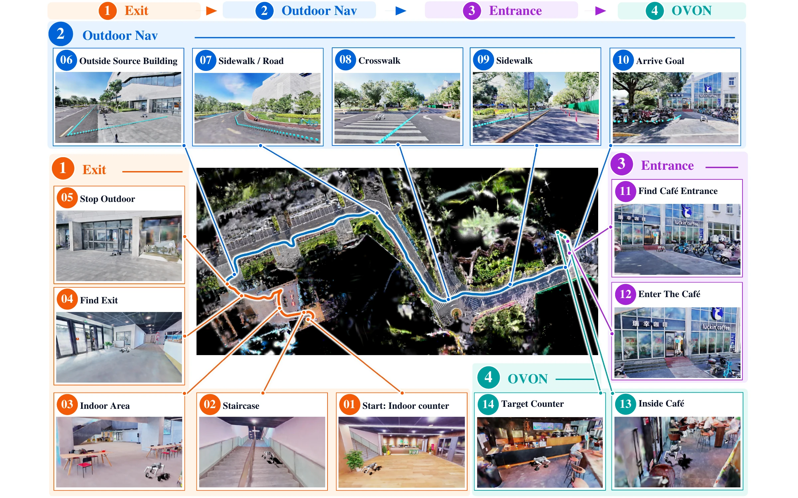
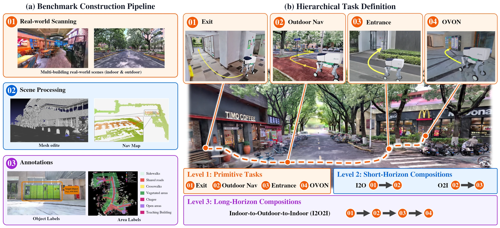
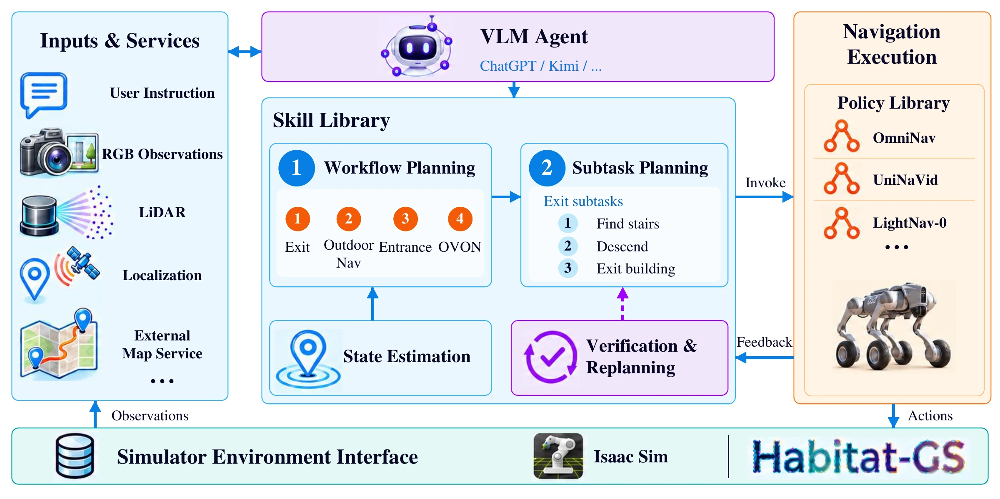

<div align="center">

# I2O2I-Nav

### A Benchmark with a Modular Agent for Long-Horizon Indoor-to-Outdoor-to-Indoor Navigation

<p>
  Zhengjie Shu<sup>1,2,*</sup> · Wanyu Li<sup>2,*</sup> · Di Xiao<sup>2,*</sup> · Lai Jiang<sup>2</sup> · Lingxin Jiang · Kaidi Hu<sup>2</sup> · Xincheng Tang<sup>2</sup><br>
  Wenkang Hu<sup>2</sup> · Haoran Wang<sup>2</sup> · Jinchuan Zhang<sup>1</sup> · Chang Chen<sup>1</sup> · Wei Li<sup>3</sup> · Jia Pan<sup>1,†</sup> · Ruigang Yang<sup>2,4,†</sup>
</p>

<p>
  <sup>1</sup> University of Hong Kong &nbsp;
  <sup>2</sup> Shanghai Jiao Tong University<br>
  <sup>3</sup> Nanjing University &nbsp;
  <sup>4</sup> Neowa
</p>

<p><sup>*</sup> Co-first authors (equal contribution). &nbsp; <sup>†</sup> Corresponding authors.</p>

[Project Page](https://i2o2i-nav.github.io/) · [Paper PDF](docs/I2O2I-Nav-project-page.pdf) · [Abstract](#abstract) · [Benchmark Overview](#benchmark-overview) · [MODULAR-Agent](#modular-agent) · [Citation](#citation)

</div>



*An indoor-to-outdoor-to-indoor mission with four stages and an illustrative route.*

## Release Status

This repository currently contains the paper and project documentation. Benchmark evaluation code and MODULAR-Agent system code will be made available here. Scene assets, annotations, and associated benchmark data are planned for release through Hugging Face; download and access details will be added when available.

Project website: <https://i2o2i-nav.github.io/>.

## Abstract

<!-- BEGIN PAPER ABSTRACT -->
Service and delivery robots often need to complete long-horizon navigation missions spanning indoor and outdoor environments. Existing embodied navigation benchmarks primarily evaluate isolated stages or partial cross-domain journeys, providing limited support for assessing how heterogeneous navigation capabilities compose under continuous execution. We introduce **I2O2I-Nav**, a physics-enabled benchmark of 20 real-world composite scenes spanning over 115,000 m² across multiple buildings and floors, with aligned 3DGS rendering and collision geometry. Its three-level evaluation progresses from independent primitives to two-stage compositions and complete four-stage I2O2I missions. Each stage starts from its predecessor's actual endpoint, while stage-conditional metrics track completion and localize failures along the mission. We further propose the **MODULAR-Agent** that coordinates frozen navigation policies through completion verification, stage handoffs, and bounded recovery.

Evaluation across 1,374 episodes highlights the difficulty of continuous composition. The MODULAR-Agent achieves 40.5–76% success on individual primitives, but full I2O2I success remains low. Compared with a fixed policy chain using the same underlying policies, it more than doubles success on both Indoor-to-Outdoor (I2O) and Outdoor-to-Indoor (O2I), while improving full-mission success from 1.15% to 4.02%. Stage-wise analysis shows that the MODULAR-Agent enables more missions to reach the final object-navigation stage, where conditional success remains low, revealing challenges in both long-horizon stage execution and completion decisions.

**Project Page:** <https://i2o2i-nav.github.io/>.
<!-- END PAPER ABSTRACT -->

## Benchmark Overview

I2O2I-Nav contains **20 reconstructed real-world composite scenes**, spanning approximately **115,602.9 m²**, with aligned 3DGS rendering and collision geometry. Scenes connect indoor and outdoor spaces across multiple buildings and floors.



The **1,374 evaluation episodes** cover three task levels:

| Level | Tasks | Evaluation episodes |
| --- | --- | --- |
| L1: Independent primitives | Exit, OutdoorNav, Entrance, OVON | 200 per primitive |
| L2: Two-stage compositions | I2O: Exit → OutdoorNav; O2I: OutdoorNav → Entrance | 200 per composition |
| L3: Full mission | Exit → OutdoorNav → Entrance → OVON | 174 |

Composed tasks run continuously without simulator resets: each stage starts from its predecessor's actual position and orientation. Stage-conditional metrics track completion and localize failures along the mission.

## MODULAR-Agent

A vision-language model coordinates frozen navigation policies through state estimation, workflow and subtask planning, completion verification, stage handoffs, and bounded recovery.



The figure shows the supported module scope. In L2/L3 evaluation, OmniNav executes Exit, Entrance, and OVON, while SocialNav executes OutdoorNav. The paper specifies the evaluated inputs, backends, and collision-constrained kinematic agent setup in Isaac Sim.

## Paper

The current preprint is available as [I2O2I-Nav-project-page.pdf](docs/I2O2I-Nav-project-page.pdf). The arXiv link and identifier will be added after they are available.

## Citation

```bibtex
@misc{shu2026i2o2inav,
  title = {I2O2I-Nav: A Benchmark with a Modular Agent for
           Long-Horizon Indoor-to-Outdoor-to-Indoor Navigation},
  author = {Zhengjie Shu and Wanyu Li and Di Xiao and Lai Jiang
            and Lingxin Jiang and Kaidi Hu and Xincheng Tang
            and Wenkang Hu and Haoran Wang and Jinchuan Zhang
            and Chang Chen and Wei Li and Jia Pan and Ruigang Yang},
  year = {2026},
  note = {Preprint},
  url = {https://i2o2i-nav.github.io/}
}
```
